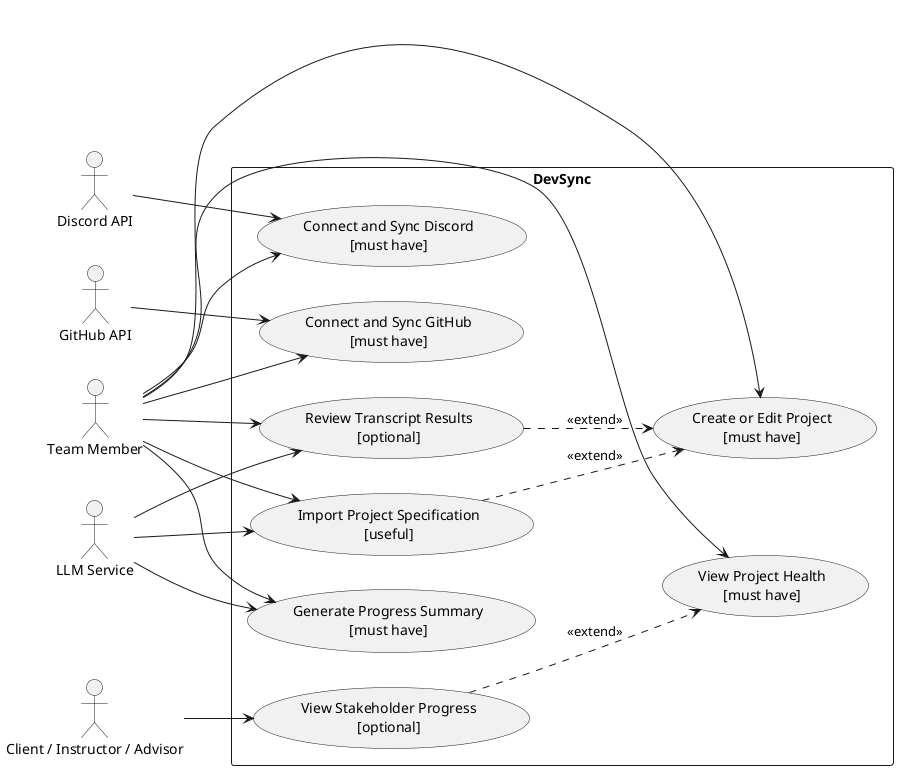
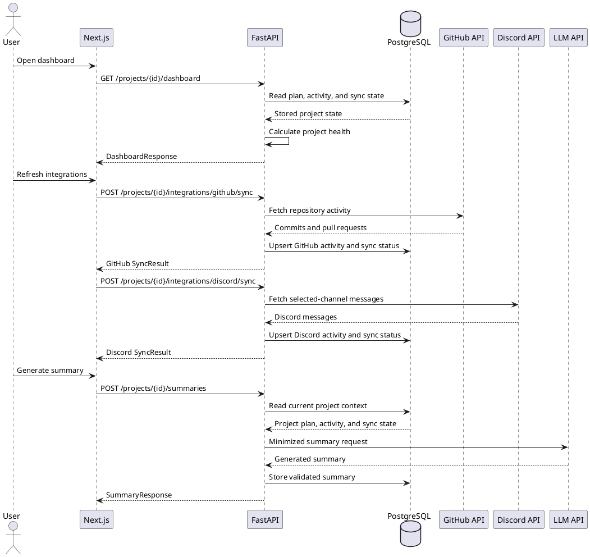
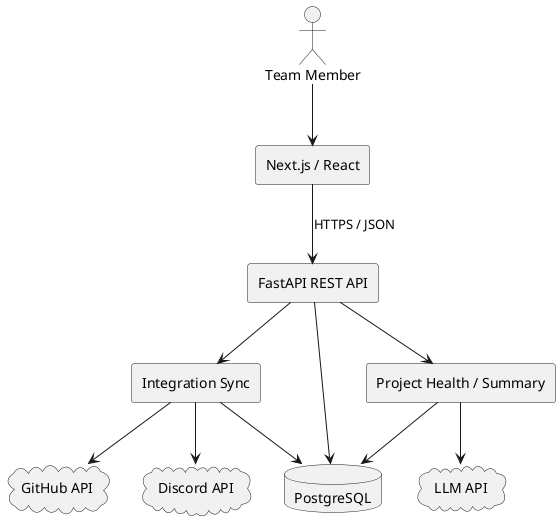

# DevSync

**Project Specification — CPSC 4390/5390**

DevSync consolidates a software team's project plan, GitHub activity, and Discord communication into a single project-health view.

## 1. Summary

DevSync is a project-health and coordination platform for small software teams. It combines a structured project plan with GitHub activity and selected Discord communication to surface progress, deadlines, blockers, integration status, and next steps in one dashboard.

Small software teams, specifically student teams, startups, and organizations without a dedicated project manager, often have to reconstruct project status from plans, repository activity, and team conversations spread across multiple tools. DevSync allows a team to define its features, milestones, deliverables, owners, and deadlines; synchronize commits and pull requests from an authorized GitHub repository; and import relevant messages from selected Discord channels. It organizes this information into a browser-based project-health dashboard showing milestone progress, upcoming deadlines, recent work, blockers, decisions, and suggested next steps. DevSync can also generate evidence-based progress summaries from stored project and activity data while clearly identifying stale or failed integrations so outdated information is not presented as current. Rather than replacing GitHub or Discord, DevSync reduces manual status reporting and helps teams recognize risks and coordination needs earlier.

## 2. Customer

DevSync's primary customers are small software-development teams that use GitHub and Discord but lack a dedicated project manager. This includes student project teams, early-stage startups, and small companies whose project plans, development activity, deadlines, blockers, and decisions are spread across multiple tools. One immediate example is CPSC 4390/5390, where many small student groups (including us) coordinate semester-long software projects through shared repositories and team communication channels, without necessarily having fully coordinated responsibilities, workflows, and means of success and productivity.

DevSync serves both contributors who need to understand recent changes and team leads who need to monitor progress, milestones, and risks. It reduces the time spent manually checking repositories, reading conversations, and asking teammates for status updates. A future secondary audience may include clients, instructors, or advisors who need a simplified milestone-level view without access to private repository data or internal team discussions.

Some of the problems our customers may face, and our solution to these include:

- **Project information is scattered across different tools.** The plan may be in a document, development work in GitHub, and important decisions in Discord. DevSync brings this information into one project dashboard.
- **It is difficult to tell whether the project is actually on schedule.** DevSync compares recent activity with the team's milestones, deliverables, and deadlines to show overall progress and project health.
- **Blockers and decisions can get buried in chat.** DevSync pulls relevant context from selected Discord channels and highlights important blockers, decisions, and action items.
- **Status updates take time to prepare.** Instead of manually reviewing commits, pull requests, and messages, teams can use DevSync's progress summary to see recent work and likely next steps.
- **Information can become outdated.** DevSync shows synchronization status and the last successful update so users know whether the dashboard reflects current GitHub and Discord activity.

## 3. Competitive Landscape

DevSync competes mainly with the combination of tools teams already use rather than a single direct replacement.

| Alternative | What it does today | DevSync difference |
|---|---|---|
| GitHub Projects | Tracks issues/PRs and repository work. | Adds project-plan + Discord context and cross-source status. |
| Jira / Linear | Tracks planned work, tickets, owners, and status. | Reduces manual status upkeep by deriving context from actual activity. |
| Discord / Slack | Preserves team discussion. | Adds blockers/decisions beside repository progress. |

## 4. User Requirements

### Project setup

- **UR-1:** Users shall be able to create and edit a project with a summary, features, milestones, deliverables, and deadlines.
- **UR-2:** Where document-assisted onboarding is included, users shall be able to upload a supported specification and review extracted project fields before saving.

### Integrations

- **UR-3:** Users shall be able to connect a GitHub repository and synchronize supported repository activity.
- **UR-4:** Users shall be able to connect at least one Discord channel and synchronize project-relevant messages.
- **UR-5:** The UI shall show each integration's latest successful sync and any failure/stale state.

### Dashboard and summaries

- **UR-6:** Users shall be able to view project-plan data alongside recent GitHub and Discord activity.
- **UR-7:** The dashboard shall show milestone status, upcoming deadlines, recent work, blockers, and next steps.
- **UR-8:** Users shall be able to generate a progress summary based on stored project and activity data.
- **UR-9:** Generated analysis shall not be presented as current when source integrations are stale or failed.

### Future users/features

- **UR-10:** A future stakeholder view may expose milestone-level progress without unnecessary technical/private detail.
- **UR-11:** A future transcript workflow may extract candidate requirements, decisions, and action items for user review.

## 5. Minimum Viable Product

- Create/edit a project with description, features, milestones, deliverables, and deadlines.
- Connect GitHub and import commit/pull-request activity.
- Connect at least one Discord channel and import relevant messages.
- Display a combined project-health dashboard.
- Generate a progress summary with recent progress, upcoming milestones, notable activity, blockers when supported, and next steps.
- Show integration/synchronization status so stale data is not mistaken for current data.

To keep the first prototype manageable, the MVP may focus on one active project and one GitHub repository per team.

After the main workflow and the MVP is stable, tested, and consistent with our user requirements and testing, DevSync can be expanded in several ways:

- **Document-assisted onboarding:** Users could upload an existing proposal, requirements document, or README. DevSync would extract possible project fields and allow the user to review them before saving.
- **Multiple-project support:** Teams could manage several projects and use a portfolio page to compare health, deadlines, and blockers.
- **Improved activity mapping:** GitHub and Discord activity could be linked more accurately to specific features, milestones, and deliverables, with clearer evidence for generated conclusions.
- **Stakeholder views:** Clients, instructors, or advisors could receive a simplified view of milestone progress without access to private code or team discussions.
- **Meeting and transcript analysis:** DevSync could extract candidate decisions, requirements, and action items from meeting transcripts for user review.
- **Additional integrations:** Later versions could support tools such as Slack, Linear, Jira, or GitHub Projects.
- **Advanced project insights:** Future analysis could include repository-health metrics, workload trends, velocity, risk forecasting, and notifications for approaching deadlines or unresolved blockers.

## 6. Use Cases

The following use cases describe the main ways users and external services interact with DevSync. Each use case is marked as **must have**, **useful**, or **optional** based on its importance to the project.

### UC1 — Create or Edit a Project `[must have]`

**Actor:** Team member

**Supports:** UR-1

A team member creates the structured project plan that DevSync uses to monitor progress. The plan contains the project summary, features, milestones, deliverables, and deadlines.

- **UC1-AC1 — Event-driven:** WHEN a team member submits a project with valid required fields, DevSync shall save the project and return the stored information.
- **UC1-AC2 — Event-driven:** WHEN a team member submits valid changes to an existing project, DevSync shall save the updated information without changing unrelated project data.
- **UC1-AC3 — Unwanted behavior:** IF a required project field is missing or invalid, THEN DevSync shall identify the invalid field and shall not save a partial project.
- **UC1-AC4 — Unwanted behavior:** IF a team member attempts to edit a project that does not exist, THEN DevSync shall reject the request and leave existing projects unchanged.

### UC2 — Connect and Synchronize GitHub `[must have]`

**Actors:** Team member, GitHub API

**Supports:** UR-3, UR-5

A team member connects a GitHub repository to a project. DevSync retrieves supported repository activity, including commits and pull requests, for use in project monitoring.

- **UC2-AC1 — Event-driven:** WHEN a team member completes the GitHub connection and selects a repository, DevSync shall associate that repository with the project.
- **UC2-AC2 — Event-driven:** WHEN GitHub synchronization succeeds, DevSync shall store supported commits and pull requests under the connected project.
- **UC2-AC3 — Event-driven:** WHEN previously imported GitHub activity is received again, DevSync shall update or ignore the existing record rather than create a duplicate.
- **UC2-AC4 — Event-driven:** WHEN GitHub synchronization succeeds, DevSync shall record the time of the latest successful synchronization.
- **UC2-AC5 — Unwanted behavior:** IF GitHub is unavailable, rate-limited, or no longer authorized, THEN DevSync shall preserve previously synchronized data and mark the integration as failed or stale.

### UC3 — Connect and Synchronize Discord `[must have]`

**Actors:** Team member, Discord API

**Supports:** UR-4, UR-5

A team member connects one or more permitted Discord channels to a project. DevSync retrieves messages from the selected channels for project-health analysis.

- **UC3-AC1 — Event-driven:** WHEN a team member connects one or more permitted Discord channels, DevSync shall associate the selected channels with the project.
- **UC3-AC2 — Event-driven:** WHEN Discord synchronization succeeds, DevSync shall store messages from the selected channels and shall not import messages from unselected channels.
- **UC3-AC3 — Event-driven:** WHEN a previously imported Discord message is received again, DevSync shall update or ignore the existing record rather than create a duplicate.
- **UC3-AC4 — Event-driven:** WHEN Discord synchronization succeeds, DevSync shall record the time of the latest successful synchronization.
- **UC3-AC5 — Unwanted behavior:** IF Discord synchronization fails or access is revoked, THEN DevSync shall preserve previously synchronized data and mark the integration as failed or stale.

### UC4 — View Project Health `[must have]`

**Actor:** Team member

**Supports:** UR-5, UR-6, UR-7, UR-9

A team member views the current state of a project. DevSync combines the project plan with stored GitHub and Discord activity to present progress, deadlines, blockers, and other health information.

- **UC4-AC1 — Event-driven:** WHEN a team member opens the project-health dashboard, DevSync shall display the project's overall health, milestone status, upcoming deadlines, recent activity, blockers, next steps, and integration status.
- **UC4-AC2 — Event-driven:** WHEN DevSync calculates project health, DevSync shall use stored milestone progress, deadlines, blockers, and synchronized activity according to the defined health rules.
- **UC4-AC3 — Event-driven:** WHEN a team member opens a milestone, DevSync shall display its deliverables, progress, deadline, and linked project activity.
- **UC4-AC4 — Event-driven:** WHEN DevSync presents a blocker, status, or project-health conclusion, DevSync shall provide the stored activity or project information that supports it.
- **UC4-AC5 — State-driven:** WHILE an integration is stale or failed, DevSync shall display that state and shall not present its data as current.
- **UC4-AC6 — Unwanted behavior:** IF no synchronized activity is available for a project, THEN DevSync shall display an empty or unknown state rather than inventing project activity.

### UC5 — Generate a Progress Summary `[must have]`

**Actors:** Team member, LLM service

**Supports:** UR-8, UR-9

A team member requests a readable summary of the project's current progress. The summary is based on the stored project plan and synchronized activity.

- **UC5-AC1 — Event-driven:** WHEN a team member requests a progress summary, DevSync shall generate and store a summary based on the project plan and available synchronized activity.
- **UC5-AC2 — Ubiquitous:** DevSync shall organize the summary into recent progress, upcoming milestones, notable activity, supported blockers, and next steps.
- **UC5-AC3 — Ubiquitous:** DevSync shall not present a generated claim as project evidence unless it can be connected to stored project or activity data.
- **UC5-AC4 — State-driven:** WHILE one or more source integrations are stale or failed, DevSync shall identify that limitation in the generated summary.
- **UC5-AC5 — Unwanted behavior:** IF the LLM service fails or returns invalid output, THEN DevSync shall preserve the last successful summary and return a recoverable error.

### UC6 — Import a Project Specification `[useful]`

**Actors:** Team member, LLM service

**Supports:** UR-2

A team member uploads an existing proposal, requirements document, or README. DevSync extracts possible project information and presents it for review. This use case is planned as an extension to the manual project-creation process.

- **UC6-AC1 — Complex:** WHERE document-assisted onboarding is included, WHEN a team member uploads a supported specification, DevSync shall present extracted candidate project fields for review.
- **UC6-AC2 — State-driven:** WHILE extracted fields are awaiting review, DevSync shall not treat them as confirmed project information.
- **UC6-AC3 — Event-driven:** WHEN a team member corrects and approves the extracted fields, DevSync shall save the reviewed values to the project.
- **UC6-AC4 — Unwanted behavior:** IF the uploaded file is unsupported or extraction fails, THEN DevSync shall display a recoverable error and preserve any existing project information.

### UC7 — View Project Progress as a Stakeholder `[optional]`

**Actor:** Client, instructor, or advisor

**Supports:** UR-10

A stakeholder views a simplified version of project progress without receiving access to private repository content or internal team discussions.

- **UC7-AC1 — Optional feature:** WHERE stakeholder access is included, DevSync shall display the project's authorized milestone progress, deadlines, and overall status.
- **UC7-AC2 — Optional feature:** WHERE stakeholder access is included, DevSync shall exclude private repository content, Discord messages, credentials, and integration settings from the stakeholder view.
- **UC7-AC3 — Unwanted behavior:** IF a stakeholder requests information outside their permissions, THEN DevSync shall reject the request without exposing the restricted information.

### UC8 — Review Information Extracted from a Meeting Transcript `[optional]`

**Actors:** Team member, LLM service

**Supports:** UR-11

A team member uploads a meeting transcript so DevSync can identify possible requirements, decisions, and action items. Extracted information must be reviewed before it affects the project plan.

- **UC8-AC1 — Complex:** WHERE transcript-assisted analysis is included, WHEN a team member uploads a supported transcript, DevSync shall present candidate requirements, decisions, and action items for review.
- **UC8-AC2 — State-driven:** WHILE extracted items have not been approved, DevSync shall not add them to the project plan.
- **UC8-AC3 — Event-driven:** WHEN a team member approves selected extracted items, DevSync shall add those items to the project.
- **UC8-AC4 — Unwanted behavior:** IF transcript processing fails or returns invalid output, THEN DevSync shall preserve the existing project plan and display a recoverable error.

### Use-case diagram


<details>
<summary>PlantUML source</summary>



</details>

## 7. Security Requirements

- Authenticate users for project/integration/private-data actions; authorize every read/write by project membership or role.
- Protect third-party tokens as secrets, never log plaintext credentials, request least-privilege scopes, and use HTTPS/TLS.
- Keep project plans, repository metadata, Discord content, and summaries confidential to authorized users.
- Minimize LLM data: send only required project context and exclude credentials/unrelated private data.
- Validate inputs; errors must not expose secrets; define deletion behavior for cached third-party data.

## 8. External Entities and Software Stack

**Stack:** TypeScript + React/Next.js frontend; Python + FastAPI backend; PostgreSQL; Docker; GitHub Actions. Hosting, authentication provider, and LLM provider remain to be finalized.

| Service | Operations / data | Failure behavior |
|---|---|---|
| GitHub API | Authorize repo; fetch commits/PRs/branches. Send token + repo/sync IDs; receive activity metadata. | Keep last good data; mark stale; retry/reconnect on auth failure. |
| Discord API | Authorize channel; fetch selected messages. Send token + channel/sync IDs; receive message text/metadata. | Keep last good data; show error; reconnect if access is revoked. |
| LLM API | Generate summaries; optionally parse specs/transcripts. Send required project/activity text; receive generated output. | Keep last good output; return error; allow retry/manual workflow. |

## 9. User Interface Requirements

- Browser-based interface with a clear project-setup flow and dashboard.
- Dashboard prioritizes status, milestones/deadlines, recent activity, blockers, next steps, and integration health.
- Connected repository/channel, last successful sync, loading/empty/error/stale states must be obvious.
- Generated summaries must be visually distinguished from source activity.
- Forms provide actionable validation; controls use semantic labels/keyboard support and status is not communicated by color alone.
- Frontend/backend data exchange uses documented JSON conforming to the OpenAPI contract.

## 10. Specification

### 10.1 Execution descriptions

- **UC1 — Create project:** Next.js sends validated plan data to FastAPI; the backend authenticates/authorizes, validates, writes project/plan records to PostgreSQL, and returns the stored project (UC1-AC1/2).
- **UC2 — GitHub sync:** the backend uses the stored integration to fetch supported activity, normalizes/upserts it, and records sync status; failures preserve prior data (UC2-AC1/2).
- **UC3 — Discord sync:** the backend fetches messages from the selected permitted channel, stores/derives required context, and records sync status; failures preserve prior data (UC3-AC1/2).
- **UC4 — Dashboard:** FastAPI reads the project plan, milestones, normalized activity, integration health, and latest summary from PostgreSQL and returns one dashboard response (UC4-AC1/2).
- **UC5 — Summary:** the backend reads current plan/activity, sends minimized context to the LLM, validates the result, stores successful output, and preserves the prior summary on provider failure (UC5-AC1/2).

### 10.2 Sequence diagram


<details>
<summary>PlantUML source</summary>



</details>

### 10.3 Application architecture


<details>
<summary>PlantUML source</summary>



</details>

### 10.4 Backend REST API (OpenAPI 3.1 draft)

```yaml
openapi: 3.1.0
info:
  title: DevSync API
  version: 0.1.0
servers:
  - url: /api
security:
  - bearerAuth: []
paths:
  /projects:
    post:
      summary: Create project
      requestBody:
        required: true
        content:
          application/json:
            schema: {$ref: '#/components/schemas/ProjectCreate'}
      responses:
        '201':
          description: Created
          content: {application/json: {schema: {$ref: '#/components/schemas/Project'}}}
        '400': {$ref: '#/components/responses/BadRequest'}
        '401': {$ref: '#/components/responses/Unauthorized'}
  /projects/{projectId}:
    get:
      summary: Get project
      parameters: [{$ref: '#/components/parameters/ProjectId'}]
      responses:
        '200':
          description: Project
          content: {application/json: {schema: {$ref: '#/components/schemas/Project'}}}
        '401': {$ref: '#/components/responses/Unauthorized'}
        '403': {$ref: '#/components/responses/Forbidden'}
        '404': {$ref: '#/components/responses/NotFound'}
    patch:
      summary: Update project
      parameters: [{$ref: '#/components/parameters/ProjectId'}]
      requestBody:
        required: true
        content:
          application/json:
            schema: {$ref: '#/components/schemas/ProjectUpdate'}
      responses:
        '200':
          description: Updated project
          content: {application/json: {schema: {$ref: '#/components/schemas/Project'}}}
        '400': {$ref: '#/components/responses/BadRequest'}
        '401': {$ref: '#/components/responses/Unauthorized'}
        '403': {$ref: '#/components/responses/Forbidden'}
        '404': {$ref: '#/components/responses/NotFound'}
  /projects/{projectId}/integrations/github:
    post:
      summary: Connect GitHub repository
      parameters: [{$ref: '#/components/parameters/ProjectId'}]
      requestBody:
        required: true
        content:
          application/json:
            schema: {$ref: '#/components/schemas/GitHubConnect'}
      responses:
        '200': {description: Connected, content: {application/json: {schema: {$ref: '#/components/schemas/IntegrationStatus'}}}}
        '400': {$ref: '#/components/responses/BadRequest'}
        '401': {$ref: '#/components/responses/Unauthorized'}
        '403': {$ref: '#/components/responses/Forbidden'}
        '502': {$ref: '#/components/responses/ExternalError'}
  /projects/{projectId}/integrations/github/sync:
    post:
      summary: Sync GitHub
      parameters: [{$ref: '#/components/parameters/ProjectId'}]
      responses:
        '200': {description: Synced, content: {application/json: {schema: {$ref: '#/components/schemas/SyncResult'}}}}
        '401': {$ref: '#/components/responses/Unauthorized'}
        '403': {$ref: '#/components/responses/Forbidden'}
        '409': {$ref: '#/components/responses/Conflict'}
        '502': {$ref: '#/components/responses/ExternalError'}
  /projects/{projectId}/integrations/discord:
    post:
      summary: Connect Discord channel
      parameters: [{$ref: '#/components/parameters/ProjectId'}]
      requestBody:
        required: true
        content:
          application/json:
            schema: {$ref: '#/components/schemas/DiscordConnect'}
      responses:
        '200': {description: Connected, content: {application/json: {schema: {$ref: '#/components/schemas/IntegrationStatus'}}}}
        '400': {$ref: '#/components/responses/BadRequest'}
        '401': {$ref: '#/components/responses/Unauthorized'}
        '403': {$ref: '#/components/responses/Forbidden'}
        '502': {$ref: '#/components/responses/ExternalError'}
  /projects/{projectId}/integrations/discord/sync:
    post:
      summary: Sync Discord
      parameters: [{$ref: '#/components/parameters/ProjectId'}]
      responses:
        '200': {description: Synced, content: {application/json: {schema: {$ref: '#/components/schemas/SyncResult'}}}}
        '401': {$ref: '#/components/responses/Unauthorized'}
        '403': {$ref: '#/components/responses/Forbidden'}
        '409': {$ref: '#/components/responses/Conflict'}
        '502': {$ref: '#/components/responses/ExternalError'}
  /projects/{projectId}/dashboard:
    get:
      summary: Get dashboard
      parameters: [{$ref: '#/components/parameters/ProjectId'}]
      responses:
        '200': {description: Dashboard, content: {application/json: {schema: {$ref: '#/components/schemas/Dashboard'}}}}
        '401': {$ref: '#/components/responses/Unauthorized'}
        '403': {$ref: '#/components/responses/Forbidden'}
        '404': {$ref: '#/components/responses/NotFound'}
  /projects/{projectId}/summaries:
    post:
      summary: Generate summary
      parameters: [{$ref: '#/components/parameters/ProjectId'}]
      responses:
        '201': {description: Summary, content: {application/json: {schema: {$ref: '#/components/schemas/Summary'}}}}
        '401': {$ref: '#/components/responses/Unauthorized'}
        '403': {$ref: '#/components/responses/Forbidden'}
        '404': {$ref: '#/components/responses/NotFound'}
        '502': {$ref: '#/components/responses/ExternalError'}
components:
  securitySchemes:
    bearerAuth: {type: http, scheme: bearer}
  parameters:
    ProjectId:
      name: projectId
      in: path
      required: true
      schema: {type: string, format: uuid}
  responses:
    BadRequest: {description: Invalid request, content: {application/json: {schema: {$ref: '#/components/schemas/Error'}}}}
    Unauthorized: {description: Authentication required, content: {application/json: {schema: {$ref: '#/components/schemas/Error'}}}}
    Forbidden: {description: Forbidden, content: {application/json: {schema: {$ref: '#/components/schemas/Error'}}}}
    NotFound: {description: Not found, content: {application/json: {schema: {$ref: '#/components/schemas/Error'}}}}
    Conflict: {description: Integration not connected, content: {application/json: {schema: {$ref: '#/components/schemas/Error'}}}}
    ExternalError: {description: External service failure, content: {application/json: {schema: {$ref: '#/components/schemas/Error'}}}}
  schemas:
    MilestoneInput:
      type: object
      required: [title, dueAt]
      properties:
        title: {type: string}
        dueAt: {type: string, format: date-time}
    Milestone:
      type: object
      required: [id, title, dueAt, status]
      properties:
        id: {type: string, format: uuid}
        title: {type: string}
        dueAt: {type: string, format: date-time}
        status: {type: string, enum: [planned, in_progress, completed, at_risk]}
    ProjectCreate:
      type: object
      required: [name, summary, features, milestones]
      properties:
        name: {type: string}
        summary: {type: string}
        features: {type: array, items: {type: string}}
        deliverables: {type: array, items: {type: string}}
        milestones: {type: array, items: {$ref: '#/components/schemas/MilestoneInput'}}
    ProjectUpdate:
      type: object
      properties:
        name: {type: string}
        summary: {type: string}
        features: {type: array, items: {type: string}}
        deliverables: {type: array, items: {type: string}}
        milestones: {type: array, items: {$ref: '#/components/schemas/MilestoneInput'}}
    Project:
      type: object
      required: [id, name, summary, features, deliverables, milestones]
      properties:
        id: {type: string, format: uuid}
        name: {type: string}
        summary: {type: string}
        features: {type: array, items: {type: string}}
        deliverables: {type: array, items: {type: string}}
        milestones: {type: array, items: {$ref: '#/components/schemas/Milestone'}}
    GitHubConnect:
      type: object
      required: [repositoryOwner, repositoryName, authorizationCode]
      properties:
        repositoryOwner: {type: string}
        repositoryName: {type: string}
        authorizationCode: {type: string}
    DiscordConnect:
      type: object
      required: [guildId, channelId, authorizationCode]
      properties:
        guildId: {type: string}
        channelId: {type: string}
        authorizationCode: {type: string}
    IntegrationStatus:
      type: object
      required: [provider, status]
      properties:
        provider: {type: string, enum: [github, discord]}
        status: {type: string, enum: [connected, syncing, healthy, stale, failed]}
        lastSuccessfulSyncAt: {type: [string, 'null'], format: date-time}
    SyncResult:
      type: object
      required: [provider, status, importedCount]
      properties:
        provider: {type: string, enum: [github, discord]}
        status: {type: string, enum: [healthy, stale, failed]}
        importedCount: {type: integer, minimum: 0}
    ActivityItem:
      type: object
      required: [id, source, kind, occurredAt, title]
      properties:
        id: {type: string}
        source: {type: string, enum: [github, discord]}
        kind: {type: string}
        occurredAt: {type: string, format: date-time}
        title: {type: string}
    Dashboard:
      type: object
      required: [project, integrations, recentActivity, blockers, nextSteps]
      properties:
        project: {$ref: '#/components/schemas/Project'}
        integrations: {type: array, items: {$ref: '#/components/schemas/IntegrationStatus'}}
        recentActivity: {type: array, items: {$ref: '#/components/schemas/ActivityItem'}}
        blockers: {type: array, items: {type: string}}
        nextSteps: {type: array, items: {type: string}}
        latestSummary:
          anyOf:
            - {$ref: '#/components/schemas/Summary'}
            - {type: 'null'}
    Summary:
      type: object
      required: [id, projectId, text, generatedAt]
      properties:
        id: {type: string, format: uuid}
        projectId: {type: string, format: uuid}
        text: {type: string}
        generatedAt: {type: string, format: date-time}
    Error:
      type: object
      required: [code, message]
      properties:
        code: {type: string}
        message: {type: string}
```

## 11. Testing and Documentation Plan

- **Frontend unit/component tests:** Vitest or Jest + React Testing Library.
- **Backend unit/API tests:** pytest + FastAPI test client/httpx.
- **Database/integration tests:** isolated PostgreSQL test database, migrations, constraints, authorization, and external-service adapters.
- **System/end-to-end tests:** Playwright for major MVP flows.
- **Acceptance tests:** map tests directly to EARS IDs (for example UC2-AC2).
- **CI:** GitHub Actions runs linting, type checks, tests, and OpenAPI validation before merge.
- **Docs:** repository README/developer setup, `docs/openapi.yaml` rendered with Swagger UI or Redoc, and code comments/docstrings for non-obvious modules.

## 12. Project Planning

Below is a table of all the possible tasks that the project will entail, along with the contributors/owners of each tasks, the estimated time it will take to complete, each task's dependencies, and the story points awarded per task. The project has been divided for seven members so that each member will contribute equally to the technical implementation and testing of the project. Even though each owner is named M1–M7, we will assign each owner tag to a respective group member based on their preferences/skills.

| Task | Owner(s) | Hrs | Depends | SP |
|---|---|---:|---|---:|
| Customer validation | Andrew | 5 | — | 3 |
| Data model + migrations | Shaunak | 8 | 1 | 5 |
| Auth + project access | Miguel | 8 | 2 | 5 |
| Project API | Shaunak | 8 | 2, 3 | 5 |
| Project setup UI | Andrew | 8 | 4 | 5 |
| Dashboard backend | Eric | 10 | 2, 4 | 8 |
| Dashboard frontend | Lena | 10 | 6 | 8 |
| GitHub integration | Daniel | 14 | 2, 3 | 8 |
| Discord integration | Sid | 14 | 2, 3 | 8 |
| Integration UI/status | Miguel | 8 | 8, 9 | 5 |
| Health/normalization logic | Eric | 12 | 6, 8, 9 | 8 |
| LLM summary flow | Lena | 10 | 11 | 8 |
| Unit/integration/EARS tests | Eric | 12 | 4–12 | 8 |
| CI, Docker, deployment | Daniel | 8 | core app | 5 |
| Docs, OpenAPI, stabilization | Andrew | 10 | 12–14 | 5 |
